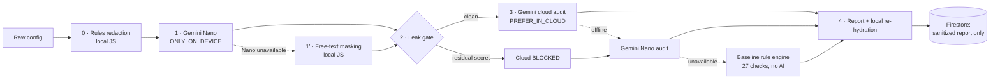

<div align="center">

# 🛡️ ChangeShield

### Privacy-first, hybrid-AI network configuration auditor

**Your router and firewall configs never leave your laptop. Only sanitized text reaches the cloud.**

[](https://github.com/natrajexplore/ChangeShield/actions/workflows/ci.yml)


[](LICENSE)

[Why](#-why-changeshield) · [How it works](#-how-it-works) · [Features](#-features) · [Quick start](#-quick-start) · [Configuration](#%EF%B8%8F-configuration) · [Security](#-security--privacy-design) · [Troubleshooting](#-troubleshooting)

</div>

---

## 📌 Overview

ChangeShield is a browser app for network and security engineers. Paste a Cisco `show running-config`, a PAN-OS `set` export, a Junos or a FortiOS config, and it will:

1. **Redact on-device.** Deterministic rules, then **Gemini Nano running inside Chrome**, strip passwords, keys, SNMP communities, hashes, IPs, hostnames and free-text identifiers (customer names, people, sites, circuit IDs).
2. **Audit in the cloud.** **Gemini** runs a deep hardening audit on the *sanitized* config only. Each finding has a severity, evidence, why it matters, and the exact vendor CLI fix.
3. **Re-hydrate locally.** Real values live in an in-memory vault. You can reveal them in the report, but they are never sent, logged or stored.

If the cloud is unavailable, the audit falls back to Gemini Nano. If Nano is unavailable too, a **27-check deterministic rule engine** takes over, so you always get a report.

> Built for **#BuildHybridAI 2026** (Firebase AI Logic hybrid inference), category **Web (Chrome)**.

## 💡 Why ChangeShield?

Network configs are among the most sensitive files a company owns. A single running config can contain enable secrets, VPN pre-shared keys, SNMP communities, public IP ranges, customer names in interface descriptions, and carrier circuit IDs. Most security policies forbid pasting that into a cloud chatbot, so engineers either **skip the review** or **sanitize by hand**, which is slow and error-prone.

Hybrid inference fits this problem exactly. A **small on-device model** does the privacy-critical work, and a **large cloud model** does the deep reasoning, but only on text that has already been proven clean.

## 🔬 How it works



| # | Stage | Where it runs | Firebase AI Logic mode | Why |
|---|---|---|---|---|
| 0 | Rule-based redaction | Browser (JS) | — | Guarantees known secret formats are gone, even with no AI |
| 1 | Contextual redaction | **Gemini Nano, on-device** | `ONLY_ON_DEVICE` | Only a language model can tell that *"Desk of Priya Raman – Treasury"* identifies a person. Cloud fallback is **deliberately disabled** |
| 1′ | Free-text masking | Browser (JS) | — | If Nano is unavailable, every description, comment and remark is masked whole |
| 2 | Leak gate | Browser (JS) | — | Re-scans the sanitized text and **blocks** the cloud call if anything sensitive remains |
| 3 | Deep audit | **Gemini cloud**, then Nano, then rules | `PREFER_IN_CLOUD` | Best model when available, and it still works offline or on a plane |
| 3′ | Air-gapped audit | Gemini Nano / rules | `ONLY_ON_DEVICE` | For classified or regulated sites: nothing leaves the machine |
| 4 | Re-hydration | Browser memory | — | The engineer sees real values. The cloud and the database never do |

Every stage shows a live badge (`ON-DEVICE · Gemini Nano` / `CLOUD · Gemini` / `LOCAL · rules`) taken from `response.inferenceSource`, so you can see where each step ran.

## ✨ Features

**Redaction**
- **Vendors:** Cisco IOS / IOS-XE / NX-OS / ASA / Catalyst 9800 WLC, Palo Alto PAN-OS (set), Juniper Junos (set), Fortinet FortiOS. The vendor is auto-detected.
- **Secret rules:** 24 keyword-anchored rules plus block, hash, contact and IP detectors, covering:
  - enable and username secrets
  - SNMP v1/v2c/v3
  - TACACS+/RADIUS keys
  - IKE PSKs
  - OSPF/BGP/HSRP/NTP auth and key chains
  - WLAN PSKs
  - PEM and Cisco certificate blocks
  - crypt hashes, emails, phone numbers, and IPv4/IPv6 addresses
- **Weak secrets are flagged without being disclosed.** `public`, `cisco123` and short passwords become `<WEAKSECRET_n>`. The auditor reports "default SNMP community" without ever seeing the value.
- **Audit-relevant structure is preserved.** Netmasks, wildcards and `0.0.0.0` are kept, and IPs are tagged `IP_PRIV` / `IP_PUB`, so the audit can still reason about exposure.
- **Tokens are consistent.** The same host becomes `<HOST_1>` everywhere, so cross-references still make sense to the model.
- **Hallucination guard.** A value Nano suggests is masked only if it appears verbatim in the config and isn't a keyword or interface name.
- **Free-text fallback.** Without Nano, descriptions, comments and ACL remarks are masked whole (`<FREETEXT_n>`).

**Auditing**
- Cloud Gemini deep audit with **JSON-schema-constrained output on both paths** (cloud and on-device).
- **Baseline rule engine:** 27 deterministic checks, used when no AI is available (see [the table below](#-baseline-rule-checks)).
- **Security score** (0–100) with capped per-severity deductions.
- Model output is treated as untrusted: enums are validated, fields coerced, lengths capped and duplicates removed.

**Workflow**
- Three modes: **Hybrid** (recommended), **Air-gapped** (on-device only), **Cloud** (rules-only redaction).
- **Local demo mode:** with no Firebase config, everything still runs in the browser using rules plus the baseline engine.
- One-click **Copy fix**, **Markdown export** (sanitized or confidential), **Ctrl+Enter** to run.
- Saved report history (Firestore, sanitized only) for each anonymous user.

## 🧭 Inference modes

| Mode | Redaction | Audit | Data leaving the device |
|---|---|---|---|
| **Hybrid** *(recommended)* | Rules + Gemini Nano (or free-text masking) | Cloud Gemini, then Nano, then rules | Sanitized text only, after the leak gate passes |
| **Air-gapped** | Rules + Gemini Nano (or free-text masking) | Gemini Nano, then rules | **Nothing** |
| **Cloud** | Rules + free-text masking | Cloud Gemini, then rules | Sanitized text only, after the leak gate passes |

## 🚀 Quick start

### Option A: local demo (no Firebase, about 1 minute)

```bash
git clone https://github.com/natrajexplore/ChangeShield.git && cd ChangeShield
npm install
npm run dev          # http://localhost:5173
```

The header chip shows **"Firebase: not configured · local demo mode"**. Load a sample and click **Redact & audit**. Rule-based redaction and the 27-check baseline auditor run entirely in your browser.

### Option B: full hybrid AI setup

**Requirements:** Node 20+, **Chrome Desktop 139+**, and a Firebase project on the free Spark plan.

1. **Enable Gemini Nano in Chrome.** Open `chrome://flags/#prompt-api-for-gemini-nano-multimodal-input`, set it to **Enabled**, and restart Chrome. The first model download needs a few GB of free disk space.
2. **Set up the Firebase console:**
   - Create a project → add a **Web app**.
   - **AI Logic** → Get started → *Gemini Developer API* (free tier).
   - **Authentication** → Sign-in method → enable **Anonymous**.
   - **Firestore** → create a database, then deploy [`firestore.rules`](firestore.rules).
   - **App Check** → register the web app with **reCAPTCHA Enterprise**. Under *Manage debug tokens*, add your debug token (see step 3).
   - **Remote Config** is optional; defaults are compiled in.
3. **Configure:**
   ```bash
   cp .env.example .env.local   # then fill in the VITE_FIREBASE_* values from Project settings → Your apps
   ```
   > The Firebase console shows a JavaScript snippet (`const firebaseConfig = {...}`). Copy **each value** into the matching `VITE_FIREBASE_*` line. Vite only reads `KEY=value` lines.

   Start the app once, then copy the `Firebase App Check debug token: …` line from the browser DevTools console. Register it in the Firebase console and paste it into `VITE_APPCHECK_DEBUG_TOKEN` so it stays the same across browsers.
4. **Run:**
   ```bash
   npm install
   npm test       # 23 unit tests, no Firebase needed
   npm run dev    # http://localhost:5173
   ```
5. Click **Prepare on-device model** (the first download takes a few minutes), load a sample, and click **Redact & audit**.

### Deploy to Firebase Hosting

```bash
cp .firebaserc.example .firebaserc      # set your project ID
npm i -g firebase-tools && firebase login
npm run deploy                          # build + hosting + firestore rules + remote config
```

> Do **not** add `localhost` to the reCAPTCHA allowed domains. Use the App Check debug token instead, as the Firebase docs advise.

## ⚙️ Configuration

### Environment variables (`.env.local`, git-ignored)

| Variable | Required | Description |
|---|---|---|
| `VITE_FIREBASE_API_KEY` | for AI/cloud | Firebase web API key |
| `VITE_FIREBASE_AUTH_DOMAIN` | for AI/cloud | `<project>.firebaseapp.com` |
| `VITE_FIREBASE_PROJECT_ID` | for AI/cloud | Firebase project ID |
| `VITE_FIREBASE_STORAGE_BUCKET` | optional | Storage bucket |
| `VITE_FIREBASE_MESSAGING_SENDER_ID` | optional | Sender ID |
| `VITE_FIREBASE_APP_ID` | for AI/cloud | Web app ID |
| `VITE_RECAPTCHA_ENTERPRISE_SITE_KEY` | production | App Check reCAPTCHA Enterprise site key |
| `VITE_APPCHECK_DEBUG` | optional | `true` uses the App Check debug provider (always on in `npm run dev`) |
| `VITE_APPCHECK_DEBUG_TOKEN` | optional | A debug token registered in the Firebase console |

If the API key, project ID or app ID is missing, the app runs in **local demo mode**.

### Remote Config ([`remoteconfig.template.json`](remoteconfig.template.json))

| Key | Default | Bounds | Purpose |
|---|---|---|---|
| `cloud_model` | `gemini-3.5-flash-lite` | `[\w.-]{3,64}` | Cloud model for the deep audit; swap it without redeploying |
| `enable_cloud_audit` | `true` | — | **Kill switch**: `false` forces every audit on-device |
| `on_device_chunk_chars` | `12000` | 1,000–20,000 | Characters per Gemini Nano prompt chunk |
| `audit_policy_pack` | `baseline-v1` | ≤ 64 chars | Policy pack name passed to the auditor |
| `max_findings` | `25` | 1–50 | Maximum findings per report |

Out-of-range values are clamped to safe defaults, so a typo can't trigger thousands of model calls or break Firestore writes.

## 🔎 Baseline rule checks

These run locally on the sanitized text when no AI audit is available.

| Area | Checks |
|---|---|
| **Any vendor** | Default/dictionary/short secrets · DES/3DES IKE encryption · MD5/SHA-1 IKE hash · DH group 1/2/5 |
| **Cisco** | Telnet on VTY · `ip http server` · `no aaa new-model` · `enable password` · type 0/7 passwords · type 5 (MD5) hashes · password-encryption disabled · SNMP RW community · SNMPv1/v2c · `exec-timeout 0 0` · VTY without `access-class` · SSHv2 not enforced · no log timestamps · unauthenticated NTP |
| **PAN-OS** | Telnet on management · HTTP on management · any-to-any allow rule · RDP/SSH/SMB allowed from untrust · `log-end no` · SNMPv2c |
| **Junos** | Telnet service · HTTP web management |
| **FortiOS** | Telnet/HTTP in `allowaccess` |

## 🔐 Security & privacy design

- Raw config text is passed **only** to the `ONLY_ON_DEVICE` model. A runtime check aborts if `inferenceSource` is ever anything other than `on_device`.
- **The leak gate** re-runs every secret rule, checks every vault value, and looks for PEM blocks, hashes, emails and IPv4 addresses. Any hit blocks the cloud call. The UI lists the *kinds* of leak found, never the values.
- **No free text without Nano.** When contextual redaction is unavailable, descriptions, comments and remarks are masked whole before the leak gate.
- **The vault lives in JavaScript memory only:** no localStorage, no IndexedDB, no network.
- **Firestore rules** allow an explicit list of fields, bound sizes and score range, require a server timestamp, and forbid updates.
- **Anonymous auth persists** across reloads (the app waits for `authStateReady()`), so history isn't lost and duplicate users aren't created.
- **Model output is untrusted.** It is HTML-escaped and enum-validated before rendering, which prevents markup injection through severity or category fields.
- **No secrets in the repo.** `.env.local` is git-ignored, and the sample configs are entirely fictitious (RFC 5737 documentation IPs, `.example` domains).

> Firebase web config values (API key, app ID) are designed to be public in client code. Access is enforced by **App Check** and **security rules**, not by keeping them secret.

**Known limitations**
- Gemini Nano is Chrome Desktop only, and its context window is 9,216 tokens, so large configs are chunked.
- Compressed IPv6 coverage is basic.
- Contextual redaction (stage 1) is probabilistic, which is why stages 0, 1′ and 2 exist. Review the sanitized view before relying on it for regulated data.

## 🧪 Testing

```bash
npm test          # Vitest: redaction engine, leak gate, free-text masking, baseline auditor, output hardening
npm run typecheck # tsc --noEmit (strict)
npm run build     # typecheck + production bundle
```

CI ([`.github/workflows/ci.yml`](.github/workflows/ci.yml)) runs the tests and the build on every push and pull request. See [`docs/TESTING.md`](docs/TESTING.md) for a 2-minute manual test script.

## 🩺 Troubleshooting

| Symptom | Fix |
|---|---|
| Header shows **"Firebase: not configured"** | `.env.local` is missing or not in `KEY=value` format. Restart `npm run dev` after editing it |
| `auth/configuration-not-found` | Firebase console → Authentication → Sign-in method → enable **Anonymous** |
| `AppCheck: ... HTTP status: 403` | Register the debug token from the browser console under App Check → Manage debug tokens, and make sure the web app is registered in App Check |
| **Gemini Nano: unsupported** | Use Chrome Desktop 139+ and enable the `prompt-api-for-gemini-nano-multimodal-input` flag |
| **Gemini Nano: downloadable** | Click **Prepare on-device model** and wait for the download |
| Stage 2 says **Leak gate BLOCKED** | Working as designed: a residual value was detected, so the audit stayed local. Check the sanitized view |
| `Port 5173 is already in use` | Stop the other dev server, or run `npx vite --port 5174` |

## 🗂️ Project layout

```
src/
  firebase.ts              Lazy Firebase init: App Check, Auth, Firestore, Remote Config, AI Logic (demo mode if unconfigured)
  ai/models.ts             Hybrid model factories (ONLY_ON_DEVICE / PREFER_IN_CLOUD / ONLY_IN_CLOUD)
  ai/schemas.ts            JSON schemas shared by on-device + cloud structured output
  audit/baseline.ts        27-check deterministic auditor (no AI)
  redact/deterministic.ts  Rule engine, free-text masking, leak gate, vendor detection
  redact/vault.ts          In-memory token vault + nested re-hydration
  core.ts                  Pure helpers: chunking, candidate guard, scoring, output normalisation, settings clamping
  pipeline.ts              The hybrid pipeline with cloud → on-device → rules fallback
  storage.ts               Firestore persistence (sanitized reports only)
  main.ts / style.css      UI
samples/                   Fictitious Cisco IOS-XE and PAN-OS configs
tests/                     Vitest unit tests
docs/                      Testing guide, demo script, hackathon plan
firestore.rules · remoteconfig.template.json · firebase.json
```

## 🛣️ Roadmap

- Policy packs (CIS, DISA STIG, PCI-DSS) selectable through Remote Config
- Config diffing: audit only what changed between two revisions
- More vendors: Aruba AOS-CX, Arista EOS, Check Point Gaia
- SARIF / CSV export for ticketing and CI pipelines

## 🤝 Contributing

Issues and pull requests are welcome. Please run `npm test && npm run build` before opening a PR, and **never** include real device configs or credentials. Use the fictitious style of [`samples/`](samples/).

## 📄 License

[Apache License 2.0](LICENSE) © 2026 Nataraj Angappan. See [NOTICE](NOTICE).
